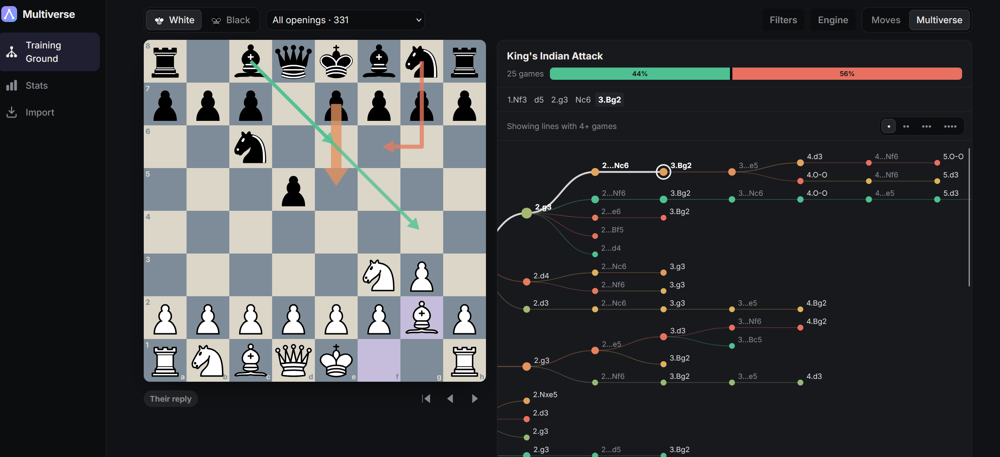

# Chess Multiverse



Hosted at: https://makspll.github.io/chess-verse/

Practice your openings from your own chess.com games. Everything runs in the browser, and games are stored locally in IndexedDB.

- **Import**: fetches your full history from the public chess.com API. Resync only fetches months that changed since the last sync.
- **Training Ground**: pick your side, then walk the tree of every position your games reached. Arrows show what you (or your opponents) played: thickness is how often, colour and label are your win rate. Click a piece to focus its moves. The **Multiverse** view shows the whole tree as a scrollable graph that follows the board. Stockfish 19 (lite, WASM) is optional.
- **Stats**: win/draw/loss by colour and opening, broken down by line.

Keys: `←` back, `→` forward (most common move), `↑` start.

## Develop

```bash
npm install
npm run dev
```

## Credits

- Pieces: cburnett set by Colin M.L. Burnett (via react-chessboard, MIT).
- Engine: [Stockfish.js](https://github.com/nmrugg/stockfish.js) (GPLv3), copied to `public/engine` at build time.
- Sounds are synthesised with WebAudio.
